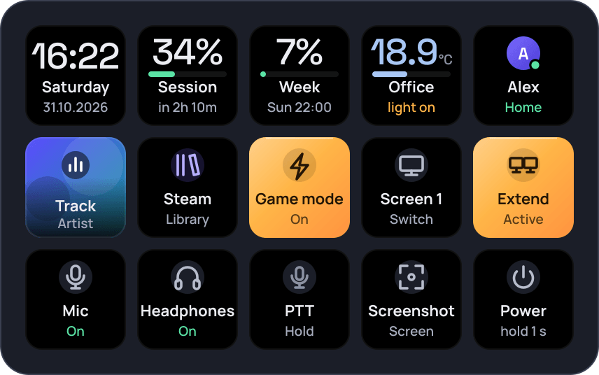
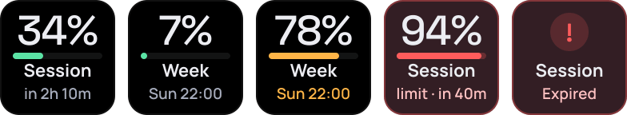
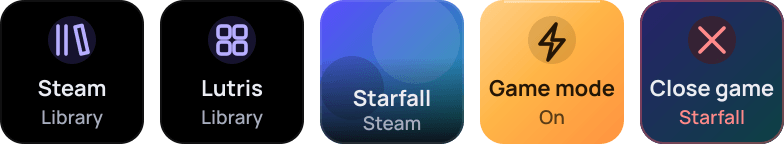
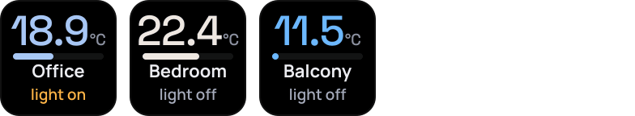
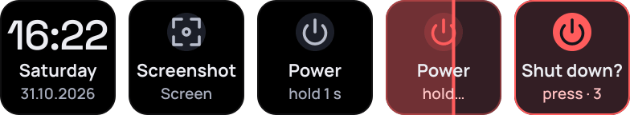

<h1 align="center">opendeck-hub</h1>

<p align="center">
  <strong>Stream Deck plugins for Linux, built for <a href="https://github.com/nekename/OpenDeck">OpenDeck</a>.</strong><br>
  Eight plugins, one consistent tile style, made for the first-generation Stream Deck (15 keys, 5x3).
</p>

<p align="center">
  <a href="https://github.com/Miwoli/opendeck-hub/actions/workflows/ci.yml"></a>
  <a href="https://github.com/Miwoli/opendeck-hub/releases"></a>
  <a href="LICENSE"></a>
  <a href="package.json"></a>
  <a href="tsconfig.base.json"></a>
  
  <a href="https://github.com/nekename/OpenDeck"></a>
</p>

<p align="center">
  
</p>

## Plugins

| Plugin | On the deck |
|---|---|
| **[Claude Usage](plugins/claude-usage)**<br>Claude.ai session and weekly usage limits, with reset times<br> |  |
| **[Discord](plugins/discord)**<br>Mic, headphones and push-to-talk in Vesktop, through a Vencord userplugin<br> |  |
| **[Displays](plugins/displays)**<br>KDE screen layouts (single screen or extended) through `kscreen-doctor`<br> |  |
| **[Games](plugins/games)**<br>Steam and Lutris libraries, recently played games, game mode, close game<br> |  |
| **[HA Map](plugins/ha-map)**<br>An OpenStreetMap of the people in Home Assistant across the deck, plus per-person keys<br> |  |
| **[Home Assistant](plugins/homeassistant)**<br>A temperature sensor on a key; pressing toggles an entity<br> |  |
| **[Media](plugins/media)**<br>Now playing over MPRIS with cover art: pause, next, switch player<br> |  |
| **[System](plugins/system)**<br>Clock, screenshot (Spectacle) and power off with hold-to-confirm<br> |  |

Every image above is generated from the plugins' own tile code (`npm run readme-images`) with sample data.

## Install

1. Download the `.streamDeckPlugin` file of a plugin from [Releases](https://github.com/Miwoli/opendeck-hub/releases)
   (one release per plugin, tagged `<plugin>-v<version>`).
2. Optionally verify it: `sha256sum -c <file>.streamDeckPlugin.sha256`.
3. In OpenDeck open **Plugins → Install from file**, pick the file and restart OpenDeck.

Each plugin's README covers its setup and settings.

**Requirements:** Linux with OpenDeck (native package or Flatpak) and a Stream Deck with keys. Only the `Keypad` controller
is supported (no dials or touch strips).

## Good to know

- **Page switching** is done by OpenDeck's built-in Starter Pack "Switch Profile" action; plugins cannot switch profiles.
- **Privacy:** no accounts, cloud services or telemetry, except where a plugin documents it (OpenStreetMap tiles in HA Map,
  the unofficial usage endpoint in Claude Usage, optional cover downloads in Media).
- **Tile style:** every plugin draws its keys with one shared renderer, so colours always mean the same thing.
  See [`docs/tile-design.md`](docs/tile-design.md).

## Development

TypeScript on Node.js, bundled with esbuild, with a small shared library ([`packages/core`](packages/core)) for the
OpenAction client, settings, the tile renderer and hold-to-confirm.

```bash
npm install
npm test                                     # unit tests + e2e tests against fake OpenDeck servers
npm run preview                              # every tile state: dist/preview/index.html + PNG files
npm run install-plugin -w plugins/<name>     # build and copy into OpenDeck's plugin directory
```

Node.js 22.18 or newer is needed for development; the plugin bundles target Node 20. Logs go to
`~/.local/share/opendeck/logs/plugins/<UUID>.sdPlugin.log`.

- [`CONTRIBUTING.md`](CONTRIBUTING.md): conventions, branches and releases
- [`docs/notes/`](docs/notes): verified facts about OpenDeck (manifest, Node runtime, profile switching, rendering)
- [`plugins/dev-preview`](plugins/dev-preview): a developer plugin that shows every tile state on a real deck (not released)

## License

[MIT](LICENSE). The exception is `plugins/discord/vencord-userplugin/`, which is derived from Vencord and licensed
[GPL-3.0-or-later](plugins/discord/vencord-userplugin/LICENSE).
