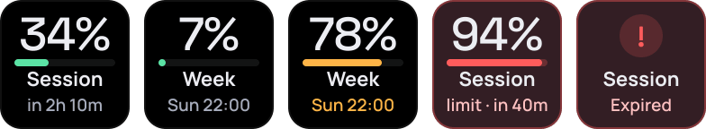

# Claude Usage

<a href="https://github.com/Miwoli/opendeck-hub/releases?q=claude-usage&expanded=true"></a>
<a href="https://github.com/Miwoli/opendeck-hub/actions/workflows/ci.yml"></a>

<a href="../../LICENSE"></a>

Two keys that show how much of your Claude.ai message limit is used: the 5-hour **session** limit and the **weekly** limit.
Each key shows the percentage, a progress bar and the reset time.



`com.miwoli.claude-usage` · part of [opendeck-hub](../../README.md)

## Actions

| Action | UUID | What it does |
|---|---|---|
| Session (5 h) | `com.miwoli.claude-usage.session` | Usage of the 5-hour limit and when it resets ("in 2h 10m") |
| Week (7 d) | `com.miwoli.claude-usage.weekly` | Usage of the weekly limit and when it resets ("Sun 22:00") |

The bar is Mint below 70 %, Ember at 70-90 % and Alert above 90 %, when the whole tile turns red and the status reads
"limit · in 40m". A short press refreshes (20 s cache), a hold of >= 0.5 s forces a refresh. One request serves both keys.
Errors show a red "!" tile: "Expired" (401/403), "No network", "API error", "set key".

## Important caveat

The plugin uses the **unofficial, internal claude.ai API** that the website itself uses for its usage bar. Anthropic does
not publish an official API for Pro/Max limits, so this is reverse engineering: the endpoint can change or stop working
without notice and its use may violate the terms of service. Use it at your own risk.

Authentication is the `sessionKey` cookie from your browser. It is stored in the plugin's global settings, i.e. as plain
JSON in OpenDeck's configuration directory. That is a conscious trade-off, not a bug.

## Install

Download `com.miwoli.claude-usage.sdPlugin-<version>.streamDeckPlugin` from the
[latest Claude Usage release](https://github.com/Miwoli/opendeck-hub/releases?q=claude-usage&expanded=true) and follow
the [install steps](../../README.md#install).

## Setup

1. Add the two keys (category "Claude Usage") and open the Property Inspector.
2. Paste your `sessionKey` (browser DevTools → Application → Cookies → claude.ai → `sessionKey`, starts with `sk-ant-`) and
   save. Settings are shared by both keys.

## Security and secrets

- **Secret:** the claude.ai `sessionKey` cookie, which is a login to your Claude account. Treat it like a password.
- **Stored in:** the plugin's global settings, `~/.config/opendeck/settings/com.miwoli.claude-usage.sdPlugin.json` (plain JSON
  written by OpenDeck; also the cached organization id and refresh interval). The Property Inspector (a password field)
  reads it back from OpenDeck.
- **Sent to:** only `https://claude.ai` (`/api/organizations` and `/api/organizations/<id>/usage`), as the `Cookie` header.
  Nothing else is contacted and there is no telemetry.
- **Access needed:** the same as the logged-in website session: it can read your usage, but the key also works for anything
  else your session can do on claude.ai. Log out of claude.ai (or sign out all sessions) to revoke it.
- **Logs:** never contain the key; errors log only a category and an HTTP status.
- **Tip:** the settings file is readable by your user; check `ls -l` and `chmod 600` it if other people use the machine.

## Troubleshooting

- **A key stays empty:** usually a missing or expired `sessionKey`.
- **Logs:** `~/.local/share/opendeck/logs/plugins/com.miwoli.claude-usage.sdPlugin.log` (`[claude-usage]` lines).

## Development

```bash
npm test -w plugins/claude-usage               # build + tests + bundle smoke test
npm run install-plugin -w plugins/claude-usage # copy into OpenDeck's plugin directory (old copy is backed up)
npm run pack -w plugins/claude-usage           # -> plugins/claude-usage/dist/com.miwoli.claude-usage.sdPlugin-<version>.streamDeckPlugin
```

```
src/                  plugin code (usage client, shared service, formatting, tiles, actions)
pi/global.html        Property Inspector shared by both actions
scripts/              icon generation
com.miwoli.claude-usage.sdPlugin/   manifest (committed); bin/, images/, pi/ are generated
```
