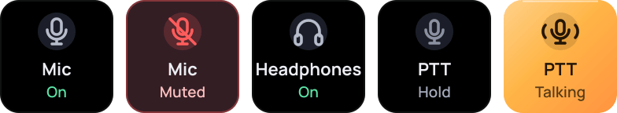

# Discord (Vesktop)

<a href="https://github.com/Miwoli/opendeck-hub/releases?q=discord&expanded=true"></a>
<a href="https://github.com/Miwoli/opendeck-hub/actions/workflows/ci.yml"></a>

<a href="../../LICENSE"></a>

Mic, Headphones and Push-to-talk for Discord in **Vesktop**. Muting happens inside Discord itself (other people see the
icon), not in PipeWire. The link is the **DeckBridge** Vencord userplugin ([`vencord-userplugin/`](vencord-userplugin),
GPL-3.0-or-later) over a local Unix socket: no network and no accounts.



`com.miwoli.discord` · part of [opendeck-hub](../../README.md)

## Actions

| Action | UUID | What it does | Tile |
|---|---|---|---|
| Mic | `com.miwoli.discord.mic` | Press toggles mute | On (Mint) / Muted, Server (Alert) |
| Headphones | `com.miwoli.discord.headphones` | Press toggles deafen | On / Muted, Server (Alert) |
| Push to talk | `com.miwoli.discord.ptt` | Hold keeps the microphone open | Hold / Talking (Ember) / "set VAD" |

Without Vesktop, or with DeckBridge disabled, the tiles show "offline" (dashed outline) and a press raises an OpenDeck
warning. State is shared by all tiles on all pages.

## Install

1. Download `com.miwoli.discord.sdPlugin-<version>.streamDeckPlugin` from the
   [latest Discord release](https://github.com/Miwoli/opendeck-hub/releases?q=discord&expanded=true) and follow the
   [install steps](../../README.md#install). The actions are in the "Discord" category.
2. Once, build Vencord with DeckBridge (needs a clone of this repository and `npm install`):
   ```bash
   npm run vencord -w plugins/discord
   ```
   This clones Vencord to `~/.local/share/opendeck-hub/vencord` (override with `VENCORD_DIR=...`), copies DeckBridge into
   `src/userplugins/`, then runs `corepack pnpm install` and `pnpm build`.
3. Vesktop → Settings → Vesktop Settings → **Developer Options** → **Vencord Location** → pick `…/vencord/dist`.
4. Restart Vesktop and enable **DeckBridge** under Vencord → Plugins.
5. Discord → Voice settings: use **Voice Activity** as the input mode. Discord's own push-to-talk only works while the
   window is focused in Vesktop, so the PTT tile unmutes the microphone for as long as it is held. The mute sounds can be
   turned off in Discord → Notifications → Sounds.

To go back to the regular Vencord: Developer Options → Vencord Location → reset. Updating Vencord means running
`npm run vencord` again (a custom location disables Vesktop's automatic updates).

## Troubleshooting

- **DeckBridge missing from the plugin list?** Check that `dist/` was not overwritten with the official Vencord:
  ```bash
  npm run vencord -w plugins/discord -- --check
  ```
  Vesktop replaces the files with the official release when it considers the directory incomplete (`ensureVencordFiles`,
  which leaves `dist/package.json` as `{}`) or after "Repair Vencord" in the tray menu. Run
  `npm run vencord -w plugins/discord`, quit Vesktop from the tray and start it again. The build uses `--disable-updater`,
  so Vencord's updater will not overwrite it by itself.
- **Plugin log:** `~/.local/share/opendeck/logs/plugins/com.miwoli.discord.sdPlugin.log`: `bridge connected`,
  `discord state {...}`, `discord offline`, `bridge unavailable: ENOENT` (Vesktop is not running or DeckBridge is disabled).
- **Vesktop:** DevTools console (Ctrl+Shift+I), prefix `[DeckBridge]` (`listening on …`).
- **Socket:** `ls -l $XDG_RUNTIME_DIR/opendeck-discord.sock` (exists only while Vesktop and DeckBridge run).

## Development

```bash
npm test -w plugins/discord               # build + tests (tiles, socket client, e2e against fakes) + bundle smoke test
npm run install-plugin -w plugins/discord
npm run pack -w plugins/discord           # -> plugins/discord/dist/com.miwoli.discord.sdPlugin-<version>.streamDeckPlugin
```
