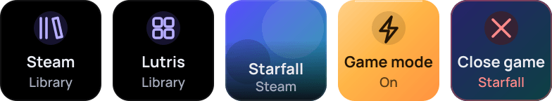

# Games

<a href="https://github.com/Miwoli/opendeck-hub/releases?q=games&expanded=true"></a>
<a href="https://github.com/Miwoli/opendeck-hub/actions/workflows/ci.yml"></a>

<a href="../../LICENSE"></a>

Steam and Lutris on your deck: library launchers, your recently played games with cover art, a game-mode toggle and a key
that closes the running game. Everything is local; no network.



`com.miwoli.games` · part of [opendeck-hub](../../README.md)

## Actions

| Action | UUID | What it does |
|---|---|---|
| Library | `com.miwoli.games.launcher` | Opens the Steam or Lutris library (choose in the Property Inspector) |
| Recently played | `com.miwoli.games.recent` | Slot 1-5: cover, name and source of a recent game; pressing launches it. The slot defaults to the key's column, so five keys in one row need no setup |
| Game mode | `com.miwoli.games.gamemode` | A toggle with state (Ember "On"), remembered in the global settings. For now it only toggles the state |
| Close game | `com.miwoli.games.closegame` | Shows the running game. Hold 1 s, release, then press within 3 s: SIGTERM to the game's processes, SIGKILL after 5 s. "no game" when nothing runs |

## Install

Download `com.miwoli.games.sdPlugin-<version>.streamDeckPlugin` from the
[latest Games release](https://github.com/Miwoli/opendeck-hub/releases?q=games&expanded=true) and follow the
[install steps](../../README.md#install). Needs Steam and/or Lutris installed for the current user.

## How it works

**Recently played** merges two sources and refreshes every minute, only while a tile is visible:

- **Steam:** `localconfig.vdf` → `LastPlayed`. Only installed games (`appmanifest_*.acf` in all libraries), without Proton /
  Steam Linux Runtime and without games hidden in the Steam library (the `user-collections.hidden` collection in
  `userdata/<id>/config/cloudstorage/cloud-storage-namespace-1.json`).
- **Lutris:** `pga.db` through the built-in `node:sqlite`, installed games only. Skipped: launchers (list in the Property
  Inspector; by default Ubisoft Connect, Epic, EA App, Battle.net, GOG Galaxy, Amazon, Rockstar), games that are the "parent"
  of other games, and games with the `steam` runner (they are already in the Steam list).

Covers come from Steam `appcache/librarycache/<appid>/[<hash>/]library_600x900.jpg` / `library_capsule.jpg` / `header.jpg`
and Lutris `coverart/<slug>.jpg`. Launching runs `steam steam://rungameid/<appid>` or `lutris lutris:rungameid/<id>`,
detached. The Library key runs `steam steam://open/games` or `lutris`.

**Close game** recognises the game by the `reaper SteamLaunch AppId=<id>` process (Steam) or `lutris-wrapper` (Lutris) and
signals only their descendants.

## Troubleshooting

- **Close game keeps saying "no game" while a game runs.** The process markers are well known but have not been observed on
  a running game yet. Open an issue with the output of `ps -eo pid,ppid,args --forest`.
- **Logs:** `~/.local/share/opendeck/logs/plugins/com.miwoli.games.sdPlugin.log` (`launch: …`, `closing steam game (marker pid …)`).

## Development

```bash
npm test -w plugins/games              # build + tests (VDF, libraries on synthetic data, /proc, e2e with a fake steam) + bundle smoke test
npm run install-plugin -w plugins/games
npm run pack -w plugins/games
```
