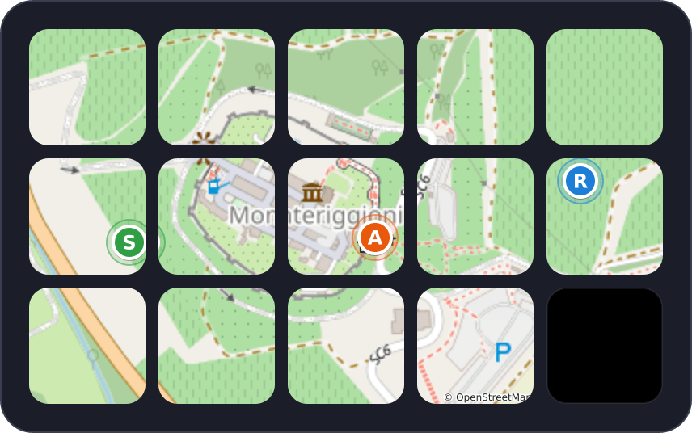

# HA Map

<a href="https://github.com/Miwoli/opendeck-hub/releases?q=ha-map&expanded=true"></a>
<a href="https://github.com/Miwoli/opendeck-hub/actions/workflows/ci.yml"></a>

<a href="../../LICENSE"></a>

An OpenStreetMap showing the current location of every person in Home Assistant, spread over the whole Stream Deck (5x3),
plus separate keys that show each person's distance from home. The map refreshes live, **but only while the map profile is
active**.




`com.miwoli.ha-map` · part of [opendeck-hub](../../README.md) · sample people around Monteriggioni, Tuscany
(map data © [OpenStreetMap](https://www.openstreetmap.org/copyright) contributors)

## Actions

| Action | UUID | What it does |
|---|---|---|
| Person | `com.miwoli.ha-map.person` | A key for one `person.*` entity: avatar (the person's Home Assistant picture, or a circle with an initial), name, distance from `zone.home` (e.g. `5.7 km`) and place (zone or "Away"). Updated by Home Assistant events |
| Map tile | `com.miwoli.ha-map.tile` | Place it on every key of the map profile except the bottom-right one. Each instance learns its coordinates (column, row) and draws its slice of the shared map. Zoom and centre are chosen so that all people fit (initial markers, GPS accuracy circle, home icon). Pressing any tile forces a refresh |

The avatar picture is fetched from the `entity_picture` attribute of your Home Assistant server (with the token; addresses
outside the server are ignored) and can be turned off in the Property Inspector ("Avatar"). The "Under the name" option
switches between distance and place.

## Install

Download `com.miwoli.ha-map.sdPlugin-<version>.streamDeckPlugin` from the
[latest HA Map release](https://github.com/Miwoli/opendeck-hub/releases?q=ha-map&expanded=true) and follow the
[install steps](../../README.md#install).

Requirements: Home Assistant with WebSocket API access and a long-lived token, and network access to
`tile.openstreetmap.org` (or another tile server).

## Setup

1. In Home Assistant create a token: user profile → Security → Long-lived access tokens.
2. In OpenDeck add any action from the **HA Map** category, open its Property Inspector and fill in the "Home Assistant and
   map" section: URL (e.g. `http://homeassistant.local:8123`) and token. Save. These settings are shared by all keys.
3. **Main profile:** add a "Person" action for each person and select them (the list comes from Home Assistant; you can also
   type `person.xxx`). Next to them add **OpenDeck → Switch Profile** (profile name: `Map`, any title / icon); that key opens
   the map.
4. **"Map" profile:** create a profile with that name. Put a "Map tile" on **14 keys** (all except the bottom-right one);
   copy and paste the first one. On the bottom-right key (column 5, row 3) put **OpenDeck → Switch Profile** back to the main
   profile. The back key must be in the bottom-right corner: the plugin plans the view so markers never hide under it.

Additional settings (Property Inspector): map refresh interval (default 20 s; only an extra resync, changes from Home
Assistant arrive immediately), max zoom, tile URL template and User-Agent.

## How it works

- **Profile switching is done by OpenDeck, not by the plugin.** OpenDeck accepts `switchProfile` only from the built-in
  Starter Pack plugin (see [`docs/notes/opendeck-profile-switching-notes.md`](../../docs/notes/opendeck-profile-switching-notes.md)).
  The layout is therefore two profiles with an **OpenDeck → Switch Profile** action in each direction.
- **Refresh only while active.** OpenDeck sends `willDisappear` / `willAppear` for all actions on a profile change. The plugin
  keeps the Home Assistant WebSocket connection and the refresh timer only while any key is visible (it disconnects about
  3 s after leaving the profile).

### OpenStreetMap and the tile policy

The plugin queries `tile.openstreetmap.org` according to the
[OSM tile usage policy](https://operations.osmfoundation.org/policies/tiles/): its own `User-Agent` (add your contact
details in the Property Inspector), a memory and disk cache (`~/.cache/opendeck-ha-map/`, 7 days), at most 2 parallel
downloads and no retry loop after an error (15 s pause). The "© OpenStreetMap" attribution is drawn on the map. This is fine
for use by one person; with very frequent refreshes consider your own tile server (URL template in the PI).

### Privacy and security

- No accounts, cloud or telemetry: the plugin talks only to your Home Assistant and the tile server. The tile server sees
  which **area** you view (tiles around the positions) but not who the people are.
- OpenDeck stores the Home Assistant token in `~/.config/opendeck/settings/com.miwoli.ha-map.sdPlugin.json` (plain text). Use a
  token of an account with minimal rights (the plugin only reads `person.*` and `zone.*` states).
- A plain `http://` connection to Home Assistant on a local network is unencrypted; for remote access use `https://` (the
  certificate must be trusted by Node).

## Troubleshooting

1. **Logs:** `~/.local/share/opendeck/logs/plugins/com.miwoli.ha-map.sdPlugin.log` (`[ha-map]` lines: connection to
   OpenDeck, `HA: connection started` on entering the map profile, `HA: connection stopped` after leaving it, tile errors).
   Main log: `~/.local/share/opendeck/logs/opendeck.log`.
2. **Bundle check without OpenDeck** (expect `ECONNREFUSED` on port 1):
   ```bash
   node com.miwoli.ha-map.sdPlugin/bin/plugin.cjs -port 1 -pluginUUID test -registerEvent registerPlugin -info '{}'
   ```

**Still to verify on a live OpenDeck.** Verified in the OpenDeck sources and with fakes, but worth watching on the real
application:
- SVG with embedded PNG tiles (`<image xlink:href="data:...">`) in OpenDeck's webview. If tiles are blank while markers
  show, switch to pre-rendered PNG (which needs a PNG decoder).
- Smoothness of refreshing 14 tiles at once (each image is ~20-60 kB of base64 and OpenDeck writes the profile to disk).
  If this is a problem, increase the interval or reduce the max zoom.
- Leaving the map profile right after entering it: a short flash of the "Connecting to HA" message is possible until the
  first snapshot arrives.

## Development

```bash
npm run build -w plugins/ha-map              # icons + bundle
npm test -w plugins/ha-map                   # e2e against fakes + bundle smoke test
npm run install-plugin -w plugins/ha-map     # copy into ~/.config/opendeck/plugins (the old copy goes to ~/.cache/opendeck-hub/backup)
npm run pack -w plugins/ha-map               # -> plugins/ha-map/dist/com.miwoli.ha-map.sdPlugin-<version>.streamDeckPlugin
```

`npm test` builds the bundle and runs an end-to-end test: a fake OpenDeck + a fake Home Assistant (auth, `get_states`,
`state_changed`) + a tile server. It checks 14 map tiles with markers, the person keys (`5.7 km`, `Home`), reactions to Home
Assistant events, no redraws after events of other entities, the `User-Agent`, the reply to the Property Inspector, and the
disconnect after leaving the profile and the reconnect on return. `sharp` (a devDependency) builds the icons at build time
only; the plugin runs on Node.js >= 20.

```
src/                       plugin code
  index.ts                 entry point, event routing, lifecycle of the Home Assistant connection
  actions/personAction.ts  person key
  actions/tileAction.ts    map tile, refresh timer
  ha/haClient.ts           Home Assistant WebSocket client (auth, get_states, state_changed)
  ha/store.ts              state of people and zones
  mapRenderer.ts           composes the map into one SVG per key
  tiles.ts                 tile download and cache
  geo.ts, render.ts, ...   geometry, key SVGs, protocol validation
pi/inspector.html          Property Inspector
com.miwoli.ha-map.sdPlugin/ manifest (+ bin/ and images/ after a build)
scripts/build-icons.ts     icons (build, install and pack scripts are shared in ../../scripts)
test/e2e.mjs               end-to-end test
```
