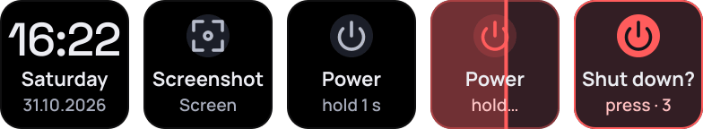

# System

<a href="https://github.com/Miwoli/opendeck-hub/releases?q=system&expanded=true"></a>
<a href="https://github.com/Miwoli/opendeck-hub/actions/workflows/ci.yml"></a>

<a href="../../LICENSE"></a>

A clock, a screenshot key (Spectacle) and a power-off key that cannot be pressed by accident.



`com.miwoli.system` · part of [opendeck-hub](../../README.md)

## Actions

| Action | UUID | What it does |
|---|---|---|
| Power | `com.miwoli.system.poweroff` | Hold 1 s (progress bar), release → "Shut down? press · 3" → press within 3 s → `systemctl poweroff` |
| Screenshot | `com.miwoli.system.screenshot` | `spectacle -b -n -f/-m/-a -o <file>` in the background → "Saved" (Mint, 2 s) |
| Clock | `com.miwoli.system.clock` | "16:22", weekday, date; redrawn once a minute, only while visible |

## Install

Download `com.miwoli.system.sdPlugin-<version>.streamDeckPlugin` from the
[latest System release](https://github.com/Miwoli/opendeck-hub/releases?q=system&expanded=true) and follow the
[install steps](../../README.md#install). Screenshot needs KDE Spectacle. The actions are in the "System" category.

## How it works

- **Power:** the hold is measured keyDown → keyUp (`HoldToConfirm`); a short press does nothing, no confirmation within 3 s
  cancels, and the tile disappearing (profile change) cancels too.
- **Screenshot:** the Property Inspector chooses full desktop / current monitor / active window and the folder (default
  `<Pictures>/Screenshots`, where `<Pictures>` comes from `~/.config/user-dirs.dirs`). Files are named
  `Screenshot_YYYYMMDD_HHMMSS.png`. An error shows an "error" tile and an OpenDeck warning.
- All commands use `execFile` with an argument array and a timeout.

## Troubleshooting

- **Logs:** `~/.local/share/opendeck/logs/plugins/com.miwoli.system.sdPlugin.log` (`power off confirmed`, `screenshot saved: …`).

## Development

```bash
npm test -w plugins/system             # build + unit and e2e tests + bundle smoke test
npm run install-plugin -w plugins/system
npm run pack -w plugins/system
```

Tests use fakes (`OPENDECK_SYSTEMCTL`, `OPENDECK_SPECTACLE`) and never power anything off.
